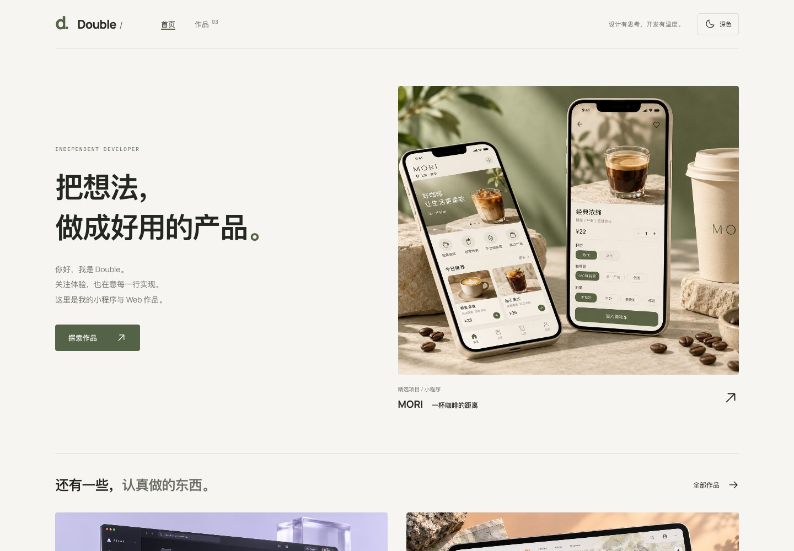
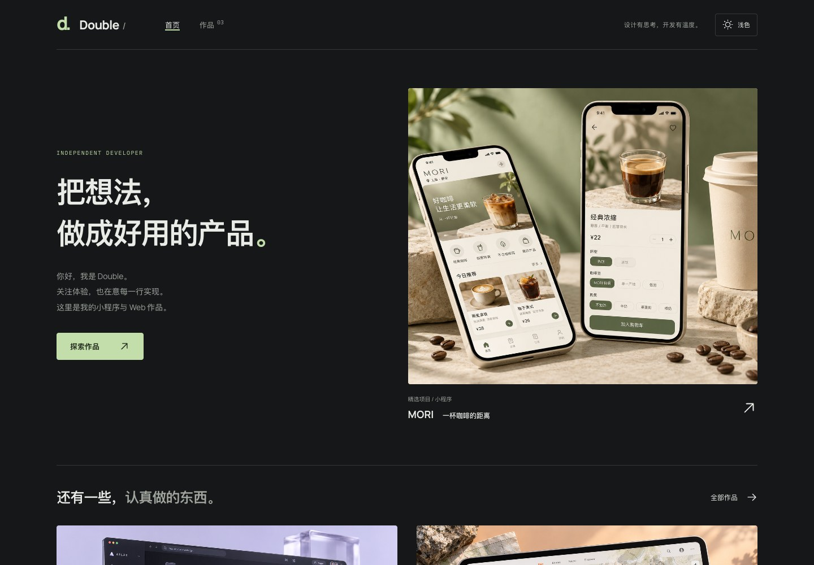
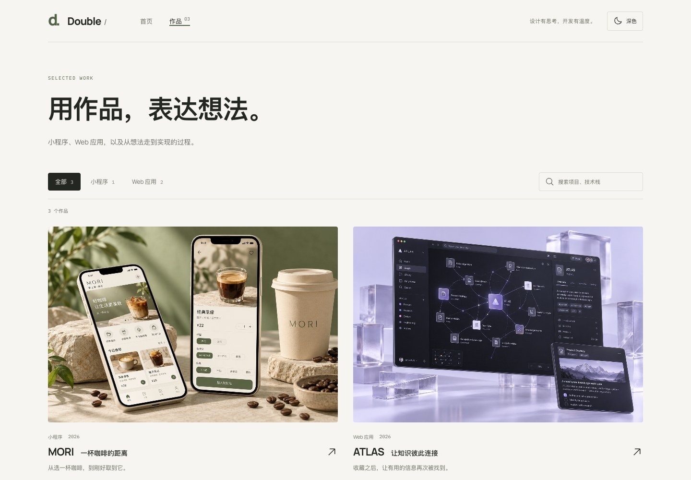
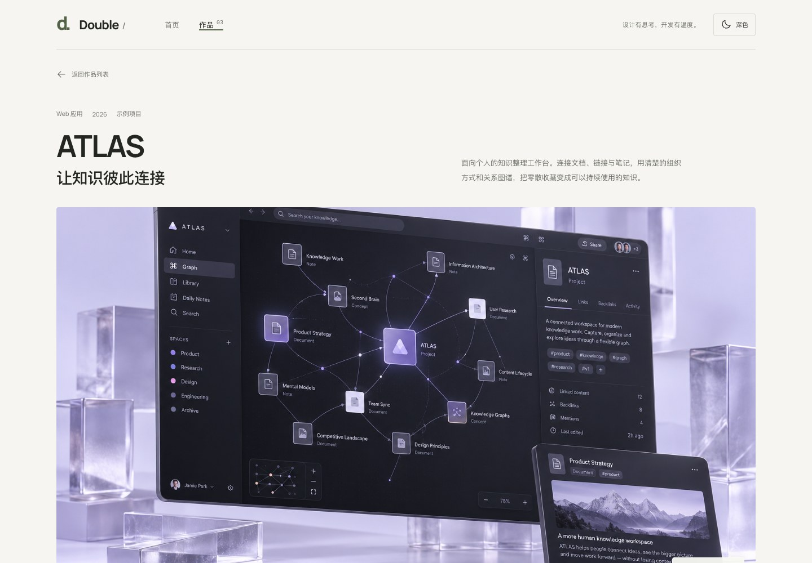
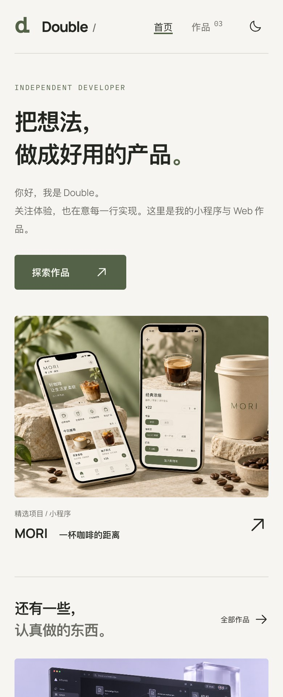
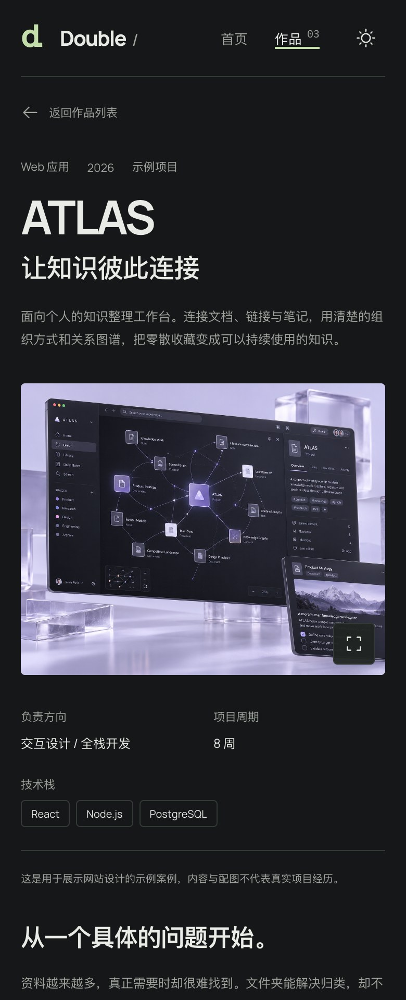

# Folio Nest

**Folio Nest** 是基于 **React + TypeScript + Vite** 的个人作品集网站，用于展示小程序、Web 应用和项目案例。通过 JSON 维护作品内容，图片使用 URL 引用，构建后可部署为静态网站，无需数据库或常驻后端服务。

首页、作品列表和详情页采用统一的留白编辑布局，支持浅色与深色主题。当前附带的 MORI、ATLAS、TRAIL 为示例案例，上线前请替换为自己的真实作品。

## 目录

- [界面预览](#界面预览)
- [功能特性](#功能特性)
- [技术栈](#技术栈)
- [快速开始](#快速开始)
- [配置个人信息](#配置个人信息)
- [开发与验证](#开发与验证)
- [添加和管理作品](#添加和管理作品)
- [数据存储与外部 JSON](#数据存储与外部-json)
- [部署](#部署)
- [命令速查](#命令速查)
- [项目结构](#项目结构)
- [常见问题](#常见问题)
- [参与开发](#参与开发)
- [许可证](#许可证)

## 界面预览

以下为网站实际运行截图，展示仓库自带的示例项目。点击图片可以查看原图。

| 首页 · 浅色主题                                                                                                    | 首页 · 深色主题                                                                                                      |
| ------------------------------------------------------------------------------------------------------------------ | -------------------------------------------------------------------------------------------------------------------- |
| [](docs/screenshots/home-light.jpg) | [](docs/screenshots/home-dark.jpg) |

| 作品列表                                                                                                  | 项目详情                                                                                                          |
| --------------------------------------------------------------------------------------------------------- | ----------------------------------------------------------------------------------------------------------------- |
| [](docs/screenshots/projects.jpg) | [](docs/screenshots/project-detail.jpg) |

<details>
<summary>移动端预览（点击展开）</summary>

<p align="center">
  <a href="docs/screenshots/mobile-home.jpg"></a>
  <a href="docs/screenshots/mobile-detail.jpg"></a>
</p>

</details>

## 功能特性

- **作品展示**：首页精选、分类筛选、关键词搜索和独立项目详情页。
- **案例表达**：项目背景、职责、技术栈、实现过程、方案取舍和结果复盘。
- **图片与体验入口**：封面、多张截图、图片放大、在线演示、源码链接和小程序码。
- **主题与适配**：响应式布局；主题首次跟随系统，手动切换后记忆偏好。
- **内容管理**：固定 JSON Schema、字段校验、草稿、发布、归档、排序和首页精选。
- **静态生成**：构建时生成页面 HTML、页面元信息和公开 JSON；配置域名后生成站点地图。
- **异常处理**：图片失败提示、内容加载重试、使用构建时内容兜底和页面内 404 提示。
- **质量检查**：TypeScript、单元测试、桌面与移动端浏览器测试、无障碍检查和 GitHub Actions CI。

目前通过编辑 JSON 管理内容，不包含登录、在线管理后台、图片上传服务或数据库。图片需自行上传到可公开访问的存储服务，或放入项目的 `public/images/` 目录。

## 技术栈

| 技术                  | 用途                             |
| --------------------- | -------------------------------- |
| React + TypeScript    | 页面组件与类型约束               |
| Vite                  | 本地开发与生产构建               |
| React Router          | 页面路由和筛选参数               |
| Zod + JSON Schema     | 运行时校验、类型推导与编辑器提示 |
| CSS 自定义属性        | 布局、响应式样式与主题配色       |
| Phosphor Icons        | 界面图标                         |
| Vitest                | 数据、加载逻辑和内容命令测试     |
| Playwright + axe-core | 浏览器交互与无障碍检查           |
| Prettier              | 代码和文档格式化                 |

具体依赖版本以 [package.json](package.json) 和 [pnpm-lock.yaml](pnpm-lock.yaml) 为准。

## 快速开始

### 环境要求

- Node.js **22.12.0 或更高版本**；项目 `.nvmrc` 和 CI 使用 Node 22。
- pnpm **11.9.0**，版本已在 `package.json` 的 `packageManager` 中固定。
- Docker 仅在选择容器部署时需要。

### 安装与启动

克隆或下载本仓库后，进入包含 `package.json` 的项目根目录。下文所有项目命令均在该目录执行。

```bash
# 确认 Node.js 版本
node --version

# 安装指定版本的包管理器
npm install --global pnpm@11.9.0

# 按锁文件安装依赖
pnpm install --frozen-lockfile

# 启动开发服务器
pnpm dev
```

默认访问地址为 <http://127.0.0.1:5173>。首次运行不需要创建环境变量文件，也不需要配置数据库。

修改 React 或 CSS 后会自动更新页面；修改 `public/content/portfolio.json` 后刷新浏览器读取新内容。使用 `Ctrl+C` 停止开发服务器。

### 本地预览生产版本

```bash
pnpm build
pnpm preview
```

默认访问地址为 <http://127.0.0.1:4173>。修改内容后，需要重新构建才能在生产预览中看到更新。端口被占用时，以终端输出的实际地址为准。

`pnpm dev` 和 `pnpm preview` 用于本地开发与检查。正式部署使用构建生成的 `dist/`。

## 配置个人信息

编辑 [public/content/portfolio.json](public/content/portfolio.json) 中的 `site` 对象：

| 字段                    | 说明                                                          |
| ----------------------- | ------------------------------------------------------------- |
| `name` / `monogram`     | 导航显示的名字与简写                                          |
| `title` / `description` | 网站标题与简介                                                |
| `tagline` / `footer`    | 顶部短句与页脚署名                                            |
| `hero.eyebrow`          | 首页的小标题                                                  |
| `hero.heading`          | 首页标题，一至两段文字组成的数组                              |
| `hero.description`      | 首页介绍，支持使用 `\n` 换行                                  |
| `publicUrl`             | 正式网站的 HTTPS 根地址，例如 `https://portfolio.example.com` |
| `isDemo`                | 替换为真实内容后设为 `false`                                  |

没有确定访问地址时可暂时省略 `publicUrl`；获得托管平台地址或绑定域名后，再补充并重新构建。该地址用于生成 canonical、绝对图片地址和站点地图，不会自动绑定域名或申请证书。

根对象的 `schemaVersion` 保持为数字 `1`。站点与每个项目各有一个 `isDemo`：站点级标记控制整体示例声明与索引策略，项目级标记控制单个案例的示例说明与索引策略。

## 开发与验证

### 日常开发

```bash
pnpm dev
pnpm typecheck
pnpm format
pnpm test
```

页面代码在 `src/pages/`，共享组件在 `src/components/`，样式在 `src/styles.css`。主题颜色通过 CSS 自定义属性切换，两种主题共用页面结构。

提交或发布前运行：

```bash
pnpm check
pnpm build
```

`pnpm check` 会依次执行本地内容校验、类型检查、单元测试与格式检查。`pnpm build` 会检查类型、读取并校验当前配置的数据源，再生成生产文件；构建不会代替全部测试。

### 浏览器测试

已安装 Google Chrome 时：

```bash
pnpm build
pnpm test:e2e
```

使用 Playwright 下载的 Chromium 时，在 macOS / Linux 执行：

```bash
pnpm exec playwright install chromium
pnpm build
PLAYWRIGHT_CHANNEL=chromium pnpm test:e2e
```

Windows PowerShell 中，设置环境变量后再执行测试：

```powershell
$env:PLAYWRIGHT_CHANNEL = "chromium"
pnpm test:e2e
```

测试会启动本地生产预览，覆盖桌面和移动端布局、两种主题、路由刷新、搜索筛选、图片放大、异常恢复、无 JavaScript 阅读和无障碍检查。截图位于 `artifacts/`，HTML 报告位于 `playwright-report/`。

查看报告：

```bash
pnpm exec playwright show-report
```

仓库内的 [.github/workflows/ci.yml](.github/workflows/ci.yml) 会在推送和 Pull Request 时执行检查、构建与浏览器测试。该工作流负责验证，不负责自动发布网站。

## 添加和管理作品

以下流程默认使用项目内的 JSON。已配置外部数据源时，本地命令仍只修改本地文件，还需完成[外部 JSON 发布流程](#配置外部-json)。

### 1. 新建草稿

```bash
pnpm content:new my-mini-app
```

命令会根据 [content/project.template.json](content/project.template.json) 在 `public/content/portfolio.json` 的 `projects` 数组末尾添加项目，初始状态为 `draft`。

`my-mini-app` 是唯一的项目 `slug`，对应详情页 `/projects/my-mini-app`。仅使用小写英文、数字和连字符；命令会拒绝重复标识，发布后尽量不要修改它。

### 2. 填写项目内容

打开 `public/content/portfolio.json`，找到新建对象并填写。下面是完整的项目对象示例，图片地址和描述需替换为实际内容：

```json
{
  "slug": "my-mini-app",
  "name": "我的小程序",
  "subtitle": "用一句话说明项目价值",
  "category": "mini-program",
  "description": "用于作品卡片的简短介绍。",
  "summary": "说明项目背景、面向的用户，以及你负责的工作。",
  "year": "2026",
  "status": "draft",
  "sortOrder": 10,
  "featured": false,
  "isDemo": false,
  "cover": {
    "url": "https://cdn.example.com/my-mini-app/cover.webp",
    "alt": "小程序首页截图"
  },
  "color": "#e5e8df",
  "tags": ["微信小程序", "TypeScript"],
  "role": "前端开发",
  "duration": "按实际项目周期填写",
  "sections": [
    {
      "id": "overview",
      "title": "项目背景",
      "paragraphs": ["描述真实的需求、目标和约束。"]
    },
    {
      "id": "implementation",
      "title": "技术实现",
      "paragraphs": ["说明自己解决的技术难点，以及方案选择与取舍。"]
    },
    {
      "id": "results",
      "title": "结果与复盘",
      "paragraphs": ["描述可验证的结果和后续改进方向。"]
    }
  ]
}
```

该示例是 `projects` 数组中的一个对象，不是整个数据文件。请保留根对象中的 `site`、`categories` 和其他项目。

常用字段：

| 字段              | 用法                                                            |
| ----------------- | --------------------------------------------------------------- |
| `category`        | 引用 `categories` 中已有的 ID，默认包含 `mini-program` 和 `web` |
| `sortOrder`       | 数值越小越靠前；相同数值时按 slug 排序                          |
| `featured`        | 首页主推；最多一个已发布项目设为 `true`                         |
| `cover`           | 封面图片，包含 `url` 和 `alt`                                   |
| `gallery`         | 可选截图数组，每张图片格式同 `cover`                            |
| `links.demo`      | 可选 HTTPS 在线体验地址                                         |
| `links.source`    | 可选 HTTPS 源码地址                                             |
| `miniProgramCode` | 可选小程序码图片，格式同 `cover`                                |
| `sections`        | 正文，支持段落、功能列表、步骤列表和可展开的补充说明            |

没有在线演示或源码时，省略相应字段，页面不会显示空按钮。可选字段不要填写 `null`。正文使用纯文本，不解析 Markdown 或 HTML。完整字段与章节示例见 [内容维护文档](docs/content.md)。

### 3. 设置图片

图片使用长期可访问的 HTTPS 链接，或网站自身的绝对路径：

```json
{
  "url": "/images/my-mini-app/cover.webp",
  "alt": "小程序首页截图"
}
```

上面的站内路径对应 `public/images/my-mini-app/cover.webp`。JSON 中仅保存链接和说明，不写入 base64 或图片二进制。

封面、截图和小程序码均采用相同格式。建议压缩图片后上传，使用 WebP/AVIF 等适合网页的格式。外部链接应允许直接访问，不依赖登录或会过期的签名；构建会检查已发布项目的站内图片是否存在，但不会逐张下载检查远程图片，请在预览时确认显示正常。

### 4. 校验、预览和发布

填写完毕后，将项目的 `status` 从 `draft` 改为 `published`。当前没有草稿预览入口，草稿在开发和生产页面中都不会显示；可先在本地改为发布状态，预览通过后再部署。

```bash
# 校验 JSON、关联字段和已发布项目的站内图片
pnpm content:validate

# 格式化内容并执行项目检查
pnpm format
pnpm check

# 构建并检查生产效果
pnpm build
pnpm preview
```

打开 `http://127.0.0.1:4173/projects/my-mini-app` 检查作品。确认后，按所用部署方式更新：Git 托管平台提交到部署分支并重新部署；Nginx 更新完整的 `dist/`；Docker 重新构建镜像并替换容器。

内容命令不会自动上传图片、修改 CDN 或部署网站。

### 5. 修改、归档或删除

直接修改对应项目对象，然后重复校验与发布流程。

| 状态        | 行为                                       |
| ----------- | ------------------------------------------ |
| `draft`     | 草稿，不展示，不进入生产 JSON 或静态 HTML  |
| `published` | 展示在作品列表，可进入首页精选和独立详情页 |
| `archived`  | 保留在源文件，不展示，不进入新的构建产物   |

首页未指定精选时使用排序第一的已发布项目，并展示最多四个其他作品；列表展示全部已发布作品。

需要下架时改为 `archived`，彻底删除时从源文件移除对象，再重新构建发布。部署时替换完整版本，避免旧详情 HTML 残留；外部 JSON 模式也需要重新部署才能移除旧静态页面中的内容，必要时同步清理 CDN 缓存。

## 数据存储与外部 JSON

### 数据契约

| 文件                                                                         | 用途                                                           |
| ---------------------------------------------------------------------------- | -------------------------------------------------------------- |
| [public/content/portfolio.json](public/content/portfolio.json)               | 默认内容源：站点信息、分类和全部项目                           |
| [public/content/portfolio.schema.json](public/content/portfolio.schema.json) | 全站 JSON Schema，Draft 2020-12，业务版本为 `schemaVersion: 1` |
| [public/content/project.schema.json](public/content/project.schema.json)     | 单个项目的 JSON Schema                                         |
| [content/project.template.json](content/project.template.json)               | 新项目草稿模板                                                 |
| [src/content/schema.ts](src/content/schema.ts)                               | TypeScript 类型、运行时校验和 Schema 生成的共同来源            |

JSON 文件的 `$schema` 为支持该标准的编辑器提供补全和校验。项目还会检查 slug 唯一、分类引用有效、章节 ID 唯一和精选数量等跨字段约束。

### 默认方式：JSON 随网站部署

不配置 `VITE_CONTENT_URL` 时，开发使用 `public/content/portfolio.json`，生产网站读取构建后的 `/content/portfolio.json`。

构建会剔除草稿与归档项目，输出到 `dist/content/portfolio.json`。每次修改后执行 `pnpm build` 并发布新的 `dist/`，即可同步 JSON、HTML 和站点地图。

### 配置外部 JSON

外部数据源适合将内容文件单独存放在对象存储、CDN 或公开 JSON 接口的场景。

先从本地内容导出公开版本：

```bash
pnpm content:validate
pnpm content:export
```

将生成的 `.output/content/` 中的 JSON 和 Schema 文件上传到自己的存储服务。需要指定输出目录时：

```bash
pnpm content:export --out .output/cdn
```

确认远端文件可访问后，在本地创建环境变量文件：

```bash
cp .env.example .env.local
```

编辑 `.env.local`：

```dotenv
VITE_CONTENT_URL=https://cdn.example.com/portfolio/portfolio.json
```

远端必须直接返回 JSON，允许无凭证读取，不依赖重定向，文件不超过 2 MB。示例响应头：

```http
Content-Type: application/json; charset=utf-8
Access-Control-Allow-Origin: https://portfolio.example.com
Cache-Control: no-cache
```

将 CORS 允许来源替换为实际作品站的地址；本地联调时也需要允许本地来源。外部 JSON 中的 `/images/...` 仍指向作品站本身，图片放在 CDN 上时应填写完整 HTTPS URL。

重新启动开发服务器，或构建生产版本：

```bash
pnpm build
pnpm preview
```

托管平台需要在构建环境单独设置 `VITE_CONTENT_URL`，因为 `.env.local` 不会提交到 Git。该值会进入浏览器代码，是公开配置，不应包含密钥。修改数据源地址后需要重新构建。

之后更新远端内容的顺序是：**修改本地 JSON → 校验 → 导出 → 上传到原地址 → 重新构建并部署网站**。内容命令仍操作本地源文件；构建会读取远端 JSON，远端不可用或内容无效时构建会失败。

| 更新内容                      | 生效方式                                          |
| ----------------------------- | ------------------------------------------------- |
| 远端 JSON 的项目文字、排序等  | 页面刷新后重新请求；实际更新速度也取决于 CDN 缓存 |
| 数据源地址 `VITE_CONTENT_URL` | 重新构建并部署                                    |
| 静态 HTML、分享预览与站点地图 | 重新构建并部署                                    |
| 下架或删除已公开内容          | 同步更新 JSON、重新构建部署，并按需清理缓存       |

浏览器读取远端失败时，会显示构建时的内容并提供重试。新增远端项目尚未重新构建时，独立地址需要服务器的 SPA 回退才能打开。

`public/` 中的文件在开发时可直接访问；不要将含草稿的源 JSON 直接用于生产托管。该目录中的图片等静态资源也会公开，源文件与发布文件的版本建议通过 Git 管理。

## 部署

项目按**域名根路径**部署，例如 `https://portfolio.example.com/`，当前不直接支持 `/portfolio/` 这样的子目录路径。部署前替换示例内容、填写 `site.publicUrl` 并设置站点及真实项目的 `isDemo: false`。

通用构建流程：

```bash
pnpm install --frozen-lockfile
pnpm check
pnpm build
```

构建成功后，`dist/` 包含首页、作品列表、每个已发布项目的 HTML、公开 JSON、资源、`404.html` 与 `robots.txt`。设置正式域名后还生成 `sitemap.xml`。未设置域名会输出提示，不阻止预览构建；示例页面带有 `noindex`，不会加入站点地图。

### 方式一：静态托管平台

以 Netlify 为例：

1. 将项目推送到自己的 GitHub 或其他受支持的 Git 仓库。
2. 在 Netlify 选择 **Add new project → Import an existing project**，授权并选择仓库。
3. 设置部署分支与下表中的构建参数。使用外部 JSON 时，再设置构建环境变量 `VITE_CONTENT_URL`。
4. 发布后检查访问地址，按需绑定自己的域名。将最终地址写回 `site.publicUrl` 并再次部署。
5. 用无痕窗口检查首页和详情，确认访客无需登录即可阅读。

| 配置项     | 值                                               |
| ---------- | ------------------------------------------------ |
| 项目根目录 | 包含 `package.json` 的目录；仓库根目录部署时留空 |
| Node.js    | `22`                                             |
| pnpm       | `11.9.0`，由 `packageManager` 指定               |
| 安装命令   | `pnpm install --frozen-lockfile`                 |
| 构建命令   | `pnpm build`                                     |
| 发布目录   | `dist`                                           |

平台具体导入步骤见 [Netlify 官方文档](https://docs.netlify.com/start/quickstarts/deploy-from-repository/)。后续更新提交到绑定的部署分支；平台开启自动部署时会重新构建，否则手动触发部署。

仓库的 [public/_redirects](public/_redirects) 与 [public/_headers](public/_headers) 会复制到构建目录，分别提供路由回退与缓存等响应头配置。已有静态页面优先，其他路径交给 React 处理，遵循 [Netlify 的 SPA 回退与静态文件优先规则](https://docs.netlify.com/manage/routing/redirects/rewrites-proxies/)。其他平台需配置同等规则，不能假设识别这些文件。

### 方式二：Nginx

1. 在本地或构建服务器执行 `pnpm build`。
2. 将完整的 `dist/` 发布到服务器的网站目录，例如 `/var/www/folio-nest`。更新时使用完整版本替换，避免已经下架的项目 HTML 留在旧目录中。
3. 以 [deploy/nginx.conf](deploy/nginx.conf) 为基础配置站点，将 `root` 改为实际目录，将 `server_name` 改为实际域名。
4. 在服务器检查并重载配置；域名解析和 HTTPS 证书按服务器环境配置。

```bash
# 以下命令在已安装 Nginx 的服务器执行
sudo nginx -t
sudo nginx -s reload
```

路由回退规则如下，完整配置还包含静态资源和 JSON 的缓存规则：

```nginx
location / {
    expires -1;
    try_files $uri $uri/ /index.html;
}
```

`/assets/` 中的构建文件带内容哈希，可以长期缓存；HTML 和 JSON 需要重新验证缓存。部署后直接访问并刷新 `/projects/你的项目标识`，检查服务器是否正确提供静态详情页或 SPA 回退。

### 方式三：Docker

仓库提供多阶段 [Dockerfile](Dockerfile)：先安装依赖并构建，再由 Nginx 提供静态文件。

```bash
# 构建镜像
docker build -t folio-nest:latest .

# 后台启动服务
docker run -d --name folio-nest --restart unless-stopped -p 8080:80 folio-nest:latest

# 查看运行日志
docker logs folio-nest
```

在运行 Docker 的机器上访问 `http://localhost:8080`。对外提供 HTTPS 时，在服务器入口配置证书与反向代理。

使用外部 JSON 时，在构建阶段传入地址：

```bash
docker build \
  --build-arg VITE_CONTENT_URL=https://cdn.example.com/portfolio/portfolio.json \
  -t folio-nest:latest .
```

Docker 构建不会复制 `.env.local`。`VITE_CONTENT_URL` 是构建参数，使用 `docker run -e VITE_CONTENT_URL=...` 不会改变已经构建的页面。

更新内容或代码后，先重新构建镜像，再替换容器。以下操作会短暂停止该站点，已有反向代理或编排服务时使用相应的发布流程：

```bash
# 使用外部 JSON 时，构建命令仍需携带相同的 --build-arg
docker build -t folio-nest:latest .
docker stop folio-nest
docker rm folio-nest
docker run -d --name folio-nest --restart unless-stopped -p 8080:80 folio-nest:latest
```

### 部署后的检查与回滚

- 直接打开首页、作品列表和一个项目地址，并刷新详情页。
- 检查手机布局、主题切换、图片、演示链接和小程序码。
- 使用外部 JSON 时，在实际域名检查 CORS 和缓存是否生效。
- 检查页面标题和正式域名；配置 `publicUrl` 后检查 `/sitemap.xml`。
- 保留上一版构建产物和对应 JSON，便于使用平台回滚或恢复上一版发布目录。

默认 SPA 回退返回 HTTP 200；未知路径会在页面内显示 404，并由客户端设置 `noindex`，不等于服务器返回 HTTP 404。若只在构建时更新内容、需要严格的 HTTP 404，可改用 `404.html` 作为服务器错误页并取消 SPA 回退；此时新增项目必须重新构建才能直接访问。

## 命令速查

| 命令                                                            | 用途                                        |
| --------------------------------------------------------------- | ------------------------------------------- |
| `pnpm dev`                                                      | 启动本地开发服务器，默认端口 5173           |
| `pnpm build`                                                    | 类型检查与生产构建，输出 `dist/`            |
| `pnpm preview`                                                  | 预览生产构建，默认端口 4173                 |
| `pnpm content:new my-project`                                   | 添加指定 slug 的草稿                        |
| `pnpm content:validate`                                         | 校验本地内容及已发布项目的站内图片          |
| `pnpm content:export`                                           | 导出公开数据和 Schema 到 `.output/content/` |
| `pnpm content:export --out .output/cdn`                         | 指定公开数据的导出目录                      |
| `pnpm content:validate --file ./portfolio-copy.json`            | 校验指定本地文件                            |
| `pnpm content:new another-project --file ./portfolio-copy.json` | 向指定本地内容文件添加草稿                  |
| `pnpm content:schema`                                           | 根据 Zod 契约重新生成 JSON Schema           |
| `pnpm typecheck`                                                | TypeScript 类型检查                         |
| `pnpm test`                                                     | 运行单元测试                                |
| `pnpm test:e2e`                                                 | 运行浏览器测试，需要先构建并准备浏览器      |
| `pnpm format`                                                   | 格式化项目文件                              |
| `pnpm format:check`                                             | 检查格式，不修改文件                        |
| `pnpm check`                                                    | 内容、类型、单元测试与格式的组合检查        |

## 项目结构

```text
folio-nest/
├── .github/workflows/       CI 检查
├── content/                新作品模板
├── deploy/                 Nginx 配置
├── docs/                   内容维护、部署与示例图片提示词
├── public/
│   ├── content/            默认 JSON 内容与生成的 Schema
│   ├── images/             可选的站内图片
│   ├── _headers            静态托管响应头配置
│   └── _redirects          静态托管路由回退
├── scripts/
│   ├── build.ts            构建、静态页面与站点地图生成
│   ├── content.ts          新增、校验和导出内容命令
│   └── content-io.ts       文件读写与图片路径校验
├── src/
│   ├── components/         共享组件、图片预览与错误处理
│   ├── content/            数据契约、加载与内容状态
│   ├── pages/              首页、列表、详情和 404
│   ├── theme/              主题状态与偏好持久化
│   ├── entry-server.tsx    构建时的 React 静态渲染
│   ├── main.tsx            浏览器入口
│   ├── seo.ts              页面元信息
│   └── styles.css          布局、主题与响应式样式
├── tests/                  单元测试与浏览器测试
├── .env.example            环境变量示例
├── Dockerfile              容器构建配置
├── package.json            依赖与项目命令
└── README.md
```

`dist/`、`.output/`、`.cache/`、`artifacts/` 和测试报告是生成文件，已在 `.gitignore` 中排除。

## 常见问题

### 添加后为什么没有显示作品？

确认 `status` 为 `published`，`category` 引用了已有分类，并执行 `pnpm content:validate`。开发页面刷新即可读取本地 JSON；生产预览需重新构建，正式站点需重新部署。外部 JSON 模式还要确认已将导出文件上传到配置的地址。

### 能否直接在浏览器后台添加作品？

当前没有管理后台。使用命令生成草稿，再编辑 JSON。以后可将 CMS 或接口输出适配为相同 Schema，复用现有页面与数据校验逻辑。

### 图片为什么没有显示？

站内路径 `/images/a.webp` 应对应 `public/images/a.webp`。外部图片需要公开 HTTPS 地址，并允许作品站直接引用。检查 URL 是否过期、是否有防盗链或登录限制，以及文件是否真实存在。页面会在加载失败时显示提示。

### JSON 更新了，为什么分享预览还是旧内容？

分享预览和静态 HTML 来自上次构建。仅更新远端 JSON 不会改写已有 HTML，需重新构建部署，并按需刷新 CDN 或分享平台缓存。

### 构建提示重复标识、分类不存在或精选数量超限怎么办？

根据错误中的字段路径检查对应对象。slug 在全站唯一，章节 ID 在单个项目内唯一，分类必须引用 `categories` 中的 ID；最多一个已发布项目可以设置 `featured: true`。

### 为什么没有 sitemap，或者页面没有被搜索引擎收录？

没有填写 `site.publicUrl` 时不生成站点地图和 canonical。`site.isDemo` 或项目的 `isDemo` 为 `true` 时，相应页面会设为 `noindex`。替换真实内容并调整标记后重新构建；这些配置本身不保证搜索引擎一定收录。

### 为什么直接刷新项目详情会出现服务器 404？

确认部署的是完整 `dist/`，服务器能提供目录下的 `index.html`，并配置了需要的路由回退。当前路由按域名根路径设计，部署到子目录还需调整路由、资源地址与构建路径，不能仅修改 Vite 的 `base`。

## 参与开发

提交问题时请说明复现步骤、Node.js / pnpm 版本，以及相关错误信息。提交界面改动时附上桌面、移动端和主题效果截图；行为变更应配套更新必要的测试与文档。

提交前运行：

```bash
pnpm format
pnpm check
pnpm build
```

涉及页面交互时再运行 `pnpm test:e2e`。修改数据契约时，运行 `pnpm content:schema` 并同时提交生成的 Schema；破坏性变更需要升级业务版本并说明迁移方式。

请勿提交 `.env.local`、访问令牌、生成目录或含敏感信息的内容文件。详细规则与用法参见 [内容维护文档](docs/content.md) 和 [部署文档](docs/deployment.md)。

## 许可证

当前仓库尚未提供 `LICENSE` 文件，未指定开源许可证。
